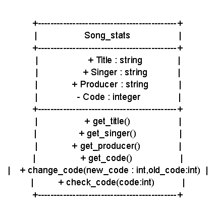
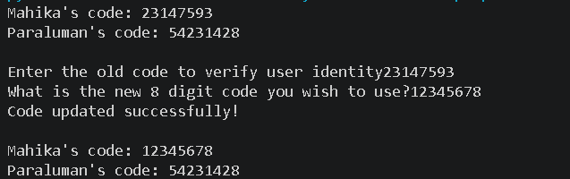
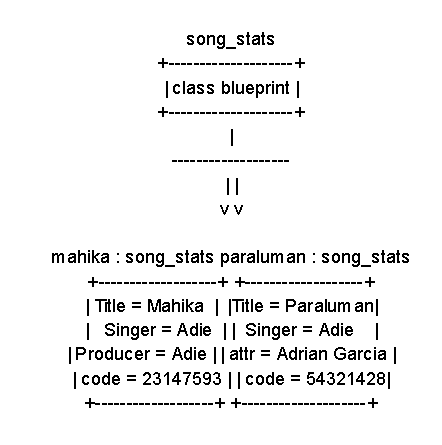

# Class Attributes and Methods
## Previous Design
Link to my previous activity:
[classObjectUML.md](q1/classObjectUML.md)
## Design Revision
Changes from my previous design:
- replace Duration with Song_code
- changed title from "Playlist" to "Song_Stats"

## Visibility Decisions
| Attribute | Data Type | Visibility | Why Public/Private? |
|---|---|---|---|
| Title | string | Public | Public since a title contains data that is needed for a user to find it|
| Singer | string | Public | Public since a Singer relies on the released songs for their fanbase and the singers can also be used to search for the songs| 
|  Song_code | int | Private | Private since this is a one time link that can be used to either share or receive songs |
| Producer | string | Public | Public since producers are also a good way to search songs |

## Updated UML Class Diagram

## Python Implementation
[View Python Source](classImplementation.py)
## Test Run

## Object Diagram

## Analysis
### Why did you make your chosen attribute private?
I made the code private since the code is needed for the changing of the code and the code allows you to share the song
### Which method changes the state of your object?
The change_code method changes the code
### How did your two objects demonstrate that instances are independent?
It demonstrated that instances are independent by only letting me change on attribute, not the attributes of both
### What is the difference between your class diagram and your object diagram?
A difference i noticed was that the class diagram was describing the things to put there as objects, while the objects diagram was actually showing the attributes of the objects